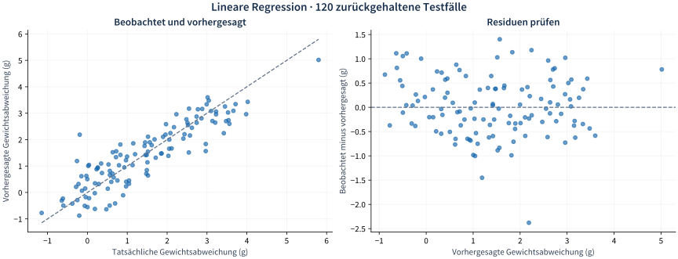
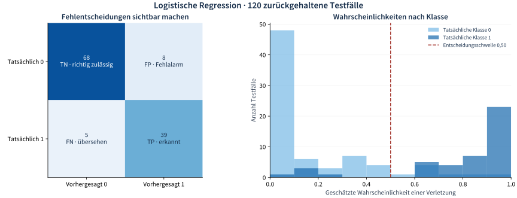
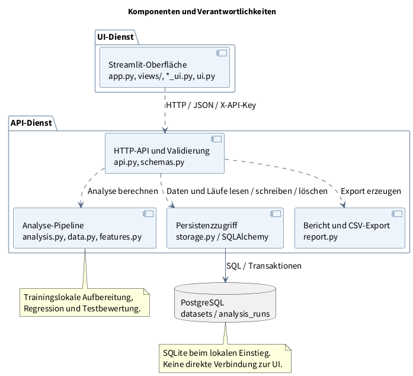

# Quality Regression Workbench

[](https://github.com/chhmaass/quality-regression-workbench/actions/workflows/tests.yml)

**Messdaten aufbereiten, Qualitätsabweichungen untersuchen und Vorhersagen nachvollziehbar bewerten.**

Eine Python-Anwendung für die Verbindung von Qualitätsmanagement, statistischer Analyse und Softwareentwicklung. Aus einer CSV-Datei entsteht ein gespeicherter Analyselauf mit expliziter Targetdefinition, ausgewählten Einflussgrößen, Bewertung an zurückgehaltenen Testfällen und exportierbarem Bericht.

**Projektstatus:** funktionsfähiger Portfolio-Prototyp mit synthetischen Beispielen und automatisierten Tests. Die Eignung für einen realen Prozess muss anhand seiner Daten und fachlichen Anforderungen geprüft werden. Die Oberfläche ist deutsch, der Quellcode englisch benannt.

## Welche QM-Frage beantwortet die Anwendung?

Eine Produktionslinie prüft das Gewicht abgefüllter Packungen. Die Messwerte schwanken. Für die Auswertung sind zwei Fragen interessant:

| Frage | Analyse | Ergebnis |
|---|---|---|
| Wie hängt die Gewichtsabweichung mit Temperatur, Geschwindigkeit oder Maschinentyp zusammen? | Lineare Regression auf Istwert minus Sollwert | Vorhergesagte Abweichung, Test-R²/RMSE, Koeffizienten und bedingte Einflusskurven |
| Unter welchen Bedingungen treten Toleranzverletzungen häufiger auf? | Logistische Regression auf einen binären Fehlerstatus | Verletzungswahrscheinlichkeiten, Precision, Recall und Konfusionsmatrix |

Targets und Features sind frei wählbar. Derselbe Ablauf lässt sich beispielsweise auf Maßabweichungen oder technische Prüfergebnisse übertragen, sofern Datenstruktur und Modellannahmen passen. Für das Beispiel wird eine CSV mit einer Zeile je Messung vorausgesetzt. Prozessmerkmale müssen vor der vorherzusagenden Qualitätsentscheidung bekannt sein.

**Fachliche Grenzen und Modellschwelle haben verschiedene Aufgaben:** Toleranzgrenzen bestimmen den tatsächlichen Fehlerstatus. Die Wahrscheinlichkeitsschwelle bestimmt, ab welchem vorhergesagten Risiko das Modell eine Verletzung meldet. Eine Änderung der Toleranzgrenzen erfordert eine neue Targetbildung und Analyse.

## Vom Import zum nachvollziehbaren Bericht

| Arbeitsbereich | Was der Nutzer dort erledigt |
|---|---|
| **Analyse vorbereiten** | CSV importieren, Datenqualität prüfen, Target und Features zuordnen, Testdesign und Aufbereitung festlegen, Fallzahlen vor dem Start prüfen |
| **Ergebnis und Bericht** | Modelle auf denselben Testfällen vergleichen, Vorhersagen und Fehlentscheidungen untersuchen, Koeffizienten interpretieren, HTML/CSV/JSON exportieren |
| **Gespeicherte Daten** | Datensätze mit Importdatum und Laufanzahl durchsuchen, Ergebnisse wieder öffnen, einzelne Läufe oder einen Datensatz samt zugehöriger Läufe nach Bestätigung löschen |

Beim Seitenwechsel bleiben die Eingaben erhalten. Veränderte Einstellungen kennzeichnen ein bisheriges Ergebnis als zu einem älteren Entwurf gehörig. Das Wiederöffnen eines Laufs stellt Datensatz und Konfiguration wieder her. Eine Datensatzlöschung entfernt zugehörige Läufe und interne Modelle in einer Transaktion. Hat sich die angezeigte Laufanzahl zwischenzeitlich geändert, verlangt die API eine erneute Bestätigung.

## Ergebnisse sichtbar machen

Die folgenden Abbildungen visualisieren **tatsächlich berechnete Backend-Ergebnisse** für [synthetische QM-Daten](examples/synthetic_qm.csv) mit den enthaltenen [linearen](examples/linear-config.json) und [logistischen](examples/logistic-config.json) Beispielkonfigurationen. Gezeigt wird jeweils das unregularisierte Referenzmodell mit 480 Trainings- und 120 Testfällen bei zufälliger Aufteilung, Seed 42. Es sind exportierte Ergebnisgrafiken, keine Screenshots der Oberfläche.



Die Oberfläche ergänzt diese Sicht um einen Modellvergleich mit Elastic Net, Koeffiziententabellen, optionale Zeitplots und ein optionales Einflussdiagramm pro Lauf. Bei Interaktionen kann dieses Diagramm beispielsweise den Temperaturzusammenhang für niedrige, mittlere und hohe Geschwindigkeit zeigen.



Für QM ist neben der Gesamtgenauigkeit entscheidend, wie viele Verletzungen übersehen werden und wie viele Fehlalarme entstehen. Deshalb werden **Accuracy, Precision, Recall und die Konfusionsmatrix** gemeinsam berichtet. Eine einfache Referenzvorhersage aus den Trainingsdaten hilft bei der Einordnung. Die Abbildungen demonstrieren die Auswertung synthetischer Daten und belegen keine Güte für einen realen Betrieb.

## Methodik mit bewusst begrenztem Umfang

### Die Testaufteilung folgt der späteren Fragestellung

| Testdesign | Trennung | Aussage der Testbewertung |
|---|---|---|
| **Unabhängiger Querschnitt** | Zufällige Messungen; bei binärem Target nach Klasse geschichtet | Neue Fälle bei fachlich vertretbarer Unabhängigkeit |
| **Neue Einheiten** | Ganze Maschinen/Einheiten bleiben im Test | Übertragbarkeit auf bisher nicht im Training enthaltene Einheiten |
| **Zukünftige Zeiträume** | Frühere Zeitpunkte trainieren, spätere testen | Vorhersagen für einen späteren Zeitraum |

Eine Einheit-ID und Zeitspalte ermöglichen einen Strukturvorschlag, ersetzen aber keine fachliche Bestätigung. Die App erkennt wiederholte Messungen, schaltet dadurch jedoch kein Mixed Model ein. Gleichzeitige Gruppen- und Zeittrennung wird nicht automatisch angeboten.

### Aufbereitung und Modellierung

- **Trainingslokale Pipeline:** Imputation, Zentrierung, Kodierung, Skalierung und gegebenenfalls PCA werden im jeweiligen Trainingsfold gelernt. Die Testdaten bestimmen diese Bezugswerte nicht mit.
- **Direkte Features:** numerische Größen, Kategorien mit Referenzkodierung, ausgewählte paarweise Interaktionen sowie zentrierter Zeitcounter und Zeitquadrat. Zeitstempel werden in Tagen verarbeitet, numerische Counter behalten ihre Eingabeeinheit, beispielsweise Stunden.
- **Regression:** lineares oder logistisches Referenzmodell, optionaler Elastic-Net-Vergleich. Dessen Parameter werden über Kreuzvalidierung ausschließlich innerhalb des Trainingsbereichs gesucht. Kein automatisches Auswählen des Gewinners anhand der Testgüte.
- **Fehlwerte:** vollständige Fälle, Median für numerische Features mit expliziter fehlender Kategorie oder ein begrenztes MICE-Vorhersageensemble aus mehreren Imputationen. Kategoriale Werte werden nicht per MICE imputiert. Fehlende Targets und Zeitangaben werden nicht aufgefüllt.
- **PCA:** optionale Hauptkomponenten aus den ausgewählten numerischen Features, nach Trainingsimputation und Standardisierung. Kategorien bleiben separat. Die Komponentenanzahl wird vorab festgelegt. Keine Kombination mit MICE, Interaktionen oder erzeugten Zeitpolynomen.
- **Nachvollziehbare Interpretation:** standardisierte Koeffizienten und Koeffizienten in Designeinheiten, Kategorienreferenzen, logistische Odds Ratios, Trainingsbezugswerte und PCA-Varianz/Komponentengewichte. Koeffizienten sind keine allgemeine Feature-Importance und belegen keine Kausalität.
- **Begrenzte Inferenz:** geeignete unregularisierte lineare Modelle können Trainingsinferenz liefern; mit Einheit-ID erst ab 20 Trainingsgruppen geclustert. Ein separater gepoolter MICE-Inferenzpfad ist für additive numerische lineare Querschnittsmodelle verfügbar. Keine pauschale Inferenz für alle Modellpfade.

Die vollständige [Methoden- und Unterstützungsmatrix](docs/methods.md) beschreibt gesperrte Kombinationen, Inferenz, unbekannte Testkategorien und weitere Grenzen. Regularisierung, PCA oder Imputation garantieren keine bessere Modellgüte. Wahrscheinlichkeiten sind nicht automatisch kalibriert; zeitliche Extrapolation und quadratische Trends erfordern besondere Vorsicht.

## Technischer Aufbau



Die [UML-Konzeption](docs/uml.md) ergänzt diese Übersicht um ein [Anwendungsfalldiagramm](docs/uml.md#anwendungsfalldiagramm) für die Nutzerziele, das erläuterte [Komponentendiagramm](docs/uml.md#komponentendiagramm) und ein [Sequenzdiagramm „Analyse starten“](docs/uml.md#sequenzdiagramm). Die editierbaren PlantUML-Quellen sind mitversioniert. Die Diagramme beschreiben den implementierten Stand.

| Baustein | Umsetzung |
|---|---|
| Datenimport und Schnittstelle | UTF-8-CSV mit Komma, Semikolon oder Tab; frei zuordenbare Spalten; FastAPI mit OpenAPI unter `/docs` |
| Backend-Logik | Validierte Konfiguration, Targetbildung, Datenaufteilung, Modellvergleich, Ergebnisaufbereitung und Export |
| Datenhaltung | SQLAlchemy und Alembic; PostgreSQL im Hosting, SQLite für den lokalen Einstieg |
| Gespeicherte Ergebnisse | Datenstand, Konfiguration, Testvorhersagen, Koeffizienten, Versionsinformationen und interne Modellartefakte |
| Datenintegrität | SHA-256 verhindert erneute Speicherung byteidentischer Uploads; unveränderte Läufe bleiben bis zur ausdrücklichen Löschung wieder aufrufbar |
| Bereitstellung | Docker Compose lokal; Railway mit API-Dienst, UI-Dienst und PostgreSQL |

Die Datenbank ist ein kleines Analysedatenlager mit zwei verknüpften Tabellen. Sie ersetzt kein normalisiertes Produktionsdatenmodell. CSV-Dateien aus vorhandenen Prüf- oder Produktionssystemen sind ein möglicher Eingang, sofern ihr Schema geeignet ist; eine direkte Geräte-, ERP- oder Cloud-Anbindung ist nicht implementiert. Details: [Architektur und Entscheidungen](docs/design.md).

## Projektstruktur

```text
quality-regression-workbench/
├── .github/
│   └── workflows/
│       └── tests.yml                   # CI mit PostgreSQL, API- und Oberflächentests
├── qmworkbench/
│   ├── __init__.py                     # Anwendungsversion
│   ├── api.py                         # HTTP-API, Zugriffsschutz und Transaktionen
│   ├── schemas.py                     # Konfiguration und Methodenvalidierung
│   ├── data.py                        # CSV-Import, Targets und Datenprofile
│   ├── features.py                    # Imputation, Zentrierung, Kodierung und PCA
│   ├── analysis.py                    # Testaufteilung, Regression und Kennzahlen
│   ├── storage.py                     # SQLAlchemy-Datenmodell und DB-Verbindung
│   ├── prepare_ui.py                  # Arbeitsbereich Analyse vorbereiten
│   ├── results_ui.py                  # Arbeitsbereich Ergebnis und Bericht
│   ├── saved_ui.py                    # Arbeitsbereich Gespeicherte Daten
│   ├── ui.py                          # Gemeinsamer Sitzungszustand und API-Client
│   ├── result_plots.py                # Vorhersage-, Koeffizienten- und PCA-Grafiken
│   └── report.py                      # HTML-Bericht und sichere CSV-Ausgabe
├── views/
│   ├── prepare.py                     # Seiteneinstieg Vorbereitung
│   ├── results.py                     # Seiteneinstieg Ergebnisse
│   └── saved.py                       # Seiteneinstieg Datenverwaltung
├── migrations/
│   ├── env.py                         # Alembic-Konfiguration
│   └── versions/
│       └── 0001_initial.py            # Tabellen datasets und analysis_runs
├── examples/
│   ├── synthetic_qm.csv               # Synthetische Mess- und Prozessdaten
│   ├── synthetic_cross_section.csv    # Synthetisches Querschnittsbeispiel
│   ├── linear-config.json
│   ├── logistic-config.json
│   ├── mice-config.json
│   └── time-interaction-config.json
├── tests/
│   ├── test_core.py                   # Fachliche Berechnungen und Validierung
│   ├── test_api.py                    # API, Persistenz, Exporte und Löschtransaktionen
│   ├── test_pca_centering.py           # PCA, Zentrierung und Ergebnisinterpretation
│   └── test_ui_access.py              # Zugangsschlüssel und sichere Fehlermeldungen
├── scripts/
│   ├── ui_smoke.py                    # Navigation und Analyseabläufe mit echter API
│   ├── saved_data_scenarios.py        # Verwaltungs- und Löschabläufe im UI-Test
│   ├── user_scenarios.py              # Acht fachliche Anwendungsszenarien
│   └── postgres_smoke.py              # PostgreSQL-Persistenz und Löschprüfung
├── docs/
│   ├── design.md                      # Architektur, Entscheidungen und Abnahmekriterien
│   ├── methods.md                     # Methoden, Annahmen und Unterstützungsmatrix
│   ├── validation.md                  # Validierungsszenarien
│   ├── railway.md                     # Bereitstellung und Betriebsprüfung
│   ├── uml.md                         # Anwendungsfälle, Komponenten und Analysesequenz
│   ├── uml/
│   │   ├── use-cases.puml             # Editierbares Anwendungsfalldiagramm
│   │   ├── components.puml            # Editierbares Komponentendiagramm
│   │   └── analysis-sequence.puml     # Editierbares Sequenzdiagramm
│   └── assets/
│       ├── linear-test-results.svg
│       ├── logistic-test-results.svg
│       ├── uml-use-cases.png
│       ├── uml-components.png
│       └── uml-analysis-sequence.png
├── app.py                             # Streamlit-Einstieg und Seitennavigation
├── Dockerfile
├── compose.yaml                       # Lokaler Betrieb mit UI, API und PostgreSQL
├── start.sh                           # Dienststart und Datenbankmigration
├── railway.toml
├── alembic.ini
├── pyproject.toml
├── requirements.txt
├── requirements.lock                  # Festgelegte Paketversionen
├── .env.example                       # Beispielkonfiguration ohne echte Zugangsdaten
├── .dockerignore
├── .gitignore
└── README.md
```

Die drei Seiteneinstiege unter `views/` rufen die jeweiligen UI-Module auf. Die Oberfläche kommuniziert über `ui.py` mit der API; Analysepipeline und Datenhaltung liegen im selben Python-Paket, werden im Hosting aber vom separaten API-Dienst ausgeführt.

## In fünf Minuten ausprobieren

1. Zugangsschlüssel eingeben und **Synthetisches QM-Beispiel laden**.
2. **Qualitätsabweichung erklären**, Target **Vorhandene Spalte → `deviation`**, numerische Features `temperature`, `throughput`, `operating_hours`, Kategorie `machine_type`. **Mit Elastic Net vergleichen** aktiviert lassen und Analyse starten.
3. **Test-R²/RMSE**, einfache Referenzvorhersage, Streudiagramm und Residuen vergleichen. Unter **Einflussgrößen** und **Modelldetails** die Koeffizienten und Aufbereitung prüfen.
4. Über **Konfiguration bearbeiten** zurückgehen. **Toleranzverletzung vorhersagen**, Target **Vorhandene Spalte → `violation`**, positive Klasse `1`. Analyse starten und **Precision, Recall, Fehlalarme und übersehene Verletzungen** prüfen.
5. HTML-Bericht und Testvorhersagen herunterladen. Unter **Gespeicherte Daten** den Lauf auswählen und wieder öffnen. Löschungen nur für nicht mehr benötigte Daten bestätigen.

**Weitere Beispiele:** Für Zeittrends `timestamp` zuordnen, Zeitcounter/Quadrat aktivieren und **Zukünftige Zeiträume** wählen; siehe [Zeit-/Interaktionskonfiguration](examples/time-interaction-config.json). Für PCA **Korrelierte Sensoren (PCA)** laden und zwei Komponenten wählen. Für MICE [synthetic_cross_section.csv](examples/synthetic_cross_section.csv) mit `deviation`, `temperature` und `throughput` verwenden; keine Einheit-ID oder Interaktionen zuordnen. Sämtliche Beispiele sind synthetisch.

## Lokal starten · Python 3.12

```bash
python3.12 -m venv .venv
source .venv/bin/activate
pip install -r requirements.lock
export WORKBENCH_API_KEY="$(python -c 'import secrets; print(secrets.token_urlsafe(32))')"
export DATABASE_URL="sqlite:///./workbench.db"
alembic upgrade head
uvicorn qmworkbench.api:app --host 127.0.0.1 --port 8000
```

In einem zweiten Terminal im selben Verzeichnis, mit aktivierter Umgebung:

```bash
streamlit run app.py
```

`http://localhost:8501` öffnen und den Wert von `WORKBENCH_API_KEY` aus dem ersten Terminal in der Seitenleiste eingeben. Die UI zeigt den Schlüssel nicht an; es gibt keinen eingebauten Standardschlüssel. Für eine API außerhalb von `http://127.0.0.1:8000` im UI-Prozess `API_BASE_URL` setzen. Unter Windows die Aktivierung und Umgebungsvariablen an die verwendete Shell anpassen.

**Docker Compose:** `.env.example` nach `.env` kopieren, beide Passwörter ersetzen, dann `docker compose up --build`. UI auf Port 8501, API auf 8000. Das Datenbankpasswort muss für die Verbindungs-URL URL-sicher sein. Persistentes Hosting und private API-Verbindung: [Railway-Anleitung](docs/railway.md).

## API und gespeicherte Daten

Alle Datenrouten benötigen `X-API-Key`. Listen sind mit `limit` (maximal 200) und `offset` paginiert. Die vollständigen Konfigurationsfelder beschreibt `/docs`; Beispiele stehen unter [examples/](examples/).

| Route | Zweck |
|---|---|
| `POST /datasets` | CSV als Multipart-Upload im Feld `file` |
| `POST /datasets/demo` | Synthetisches QM-Beispiel laden |
| `POST /datasets/demo-pca` | Synthetisches Sensorbeispiel laden |
| `GET /datasets` | Datensätze mit Importdatum, Umfang und Laufanzahl auflisten |
| `GET /datasets/{id}` | Datenprofil und Vorschau lesen |
| `POST /datasets/{id}/preview` | Target-/Fallzahlen und Testaufteilung vor der Schätzung prüfen |
| `POST /datasets/{id}/analyses` | Konfigurierte Analyse ausführen und speichern |
| `GET /datasets/{id}/analyses` | Laufübersicht mit Datum, Analyseart und Target |
| `GET /analyses/{id}` | Gespeichertes Ergebnis lesen |
| `GET /analyses/{id}/report` | Druckbarer HTML-Bericht, im Browser auch als PDF speicherbar |
| `GET /analyses/{id}/csv?model=reference` | Testvorhersagen; alternativ `elastic_net` |
| `GET /analyses/{id}/config` | Gespeicherte JSON-Konfiguration |
| `DELETE /analyses/{id}` | Einzelnen Lauf löschen; Datensatz bleibt bestehen |
| `DELETE /datasets/{id}?expected_runs=N` | Datensatz und zugehörige Läufe löschen; bei abweichender Laufanzahl HTTP 409 |
| `GET /health` | Datenbankverbindung und Anwendungsversion prüfen |

Alle Nutzer mit demselben Zugangsschlüssel teilen den Datenbestand und dessen Löschrechte. Es gibt keine getrennten Benutzerkonten oder einen Papierkorb. Die App lädt keine fremden Modellartefakte und bietet aktuell keine separate Predict-API für neue Daten.

## Qualitätssicherung

```bash
OMP_NUM_THREADS=1 OPENBLAS_NUM_THREADS=1 MKL_NUM_THREADS=1 pytest -q
OMP_NUM_THREADS=1 OPENBLAS_NUM_THREADS=1 MKL_NUM_THREADS=1 python -m scripts.ui_smoke
OMP_NUM_THREADS=1 OPENBLAS_NUM_THREADS=1 MKL_NUM_THREADS=1 python -m scripts.user_scenarios
```

| Prüfbereich | Abgedeckte Aspekte |
|---|---|
| Fachliche Berechnungen | Targetgrenzen, unbekannte Targets, Kennzahlen, Zentrierung, Interaktionen, Zeitquadrat, PCA und begrenzter MICE-Pfad |
| Testdesign | Getrennte Gruppen, zeitliche Fold-Grenzen und trainingslokale Aufbereitung |
| API und Persistenz | Zugriffsschutz, gespeicherte Ergebnisse, Exporte, paginierte Übersichten und referenzierte Datensätze |
| Löschabläufe | Gezielte Löschung, veränderte Laufanzahl, Transaktionsrollback und erneuter Import |
| Oberfläche mit echter HTTP-API | Seitenwechsel, Wiederöffnen, Konfigurationswiederherstellung, gesperrte Eingaben, Löschbestätigung und Aufräumen des Sitzungszustands |
| Fachliche Anwendungsszenarien | Acht Szenarien einschließlich linearer/logistischer Regression, Gruppen-/Zeitaufteilung, PCA und Interaktionen |
| GitHub Actions | Code- und Oberflächentests sowie PostgreSQL-Migration und Persistenz-/Löschprüfung |

Die Ergebnisabbildungen zeigen zwei dieser Analysepfade. Automatisierte Tests ersetzen keine betriebliche Abnahme; deren Kriterien sind im [Architekturdokument](docs/design.md#fachliche-abnahme) beschrieben.

## Betriebsgrenzen und nächste fachliche Prüfung

- **Umfang:** maximal 5 MiB, 10.000 Zeilen und 80 CSV-Spalten; bis zu 25 numerische und 8 kategoriale Features, 20 Kategorien je Feature, 12 Interaktionen und 150 erzeugte Designspalten.
- **Datenbasis:** mindestens 50 auswertbare Fälle; zusätzliche Klassen-, Gruppen- und Foldprüfungen. Diese Untergrenzen garantieren keine statistische Belastbarkeit.
- **Ausführung:** ein API-Prozess, eine Analyse gleichzeitig; keine Hintergrundwarteschlange. Der UI-Client wartet maximal 300 Sekunden. Ein Clientabbruch beendet die Schätzung nicht automatisch. Kein abschließendes Training auf allen Daten nach der Testbewertung.
- **Interpretation:** keine automatischen Kausalitätsnachweise, keine eigenständige Anomalieerkennung, keine Mixed Models und keine allgemeine Permutations-Feature-Importance. Koeffizienten, Interaktionen und PCA-Gewichte müssen in ihrem jeweiligen Modellkontext gelesen werden.
- **Betrieb:** gemeinsamer Zugriffsschlüssel, keine Mandantentrennung oder SSO. Für Vorführungen synthetische oder ausdrücklich freigegebene Daten verwenden. Vor einem realen Einsatz Berechtigungen, Backup, Sicherheitsupdates und zulässige Datenverarbeitung klären.

Ein sinnvoller nächster Schritt ist ein abgegrenzter betrieblicher Datensatz mit klarer Qualitätsfrage: Zielgröße und Entscheidungszeitpunkt definieren, Datenherkunft und Einheiten prüfen, passendes Testdesign wählen und die Ergebnisse fachlich bewerten. Bereits vorhandene Funktionen sind Vorleistungen; ein späterer IHK-Projektauftrag muss eigenständig und noch offen abgegrenzt werden.

Das Repository enthält keine realen Unternehmensdaten oder vertraulichen Bewerbungsmaterialien.
