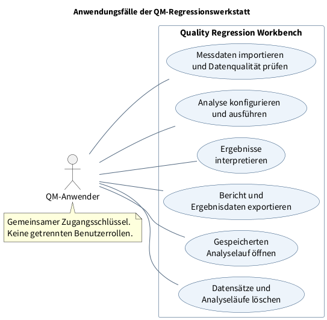
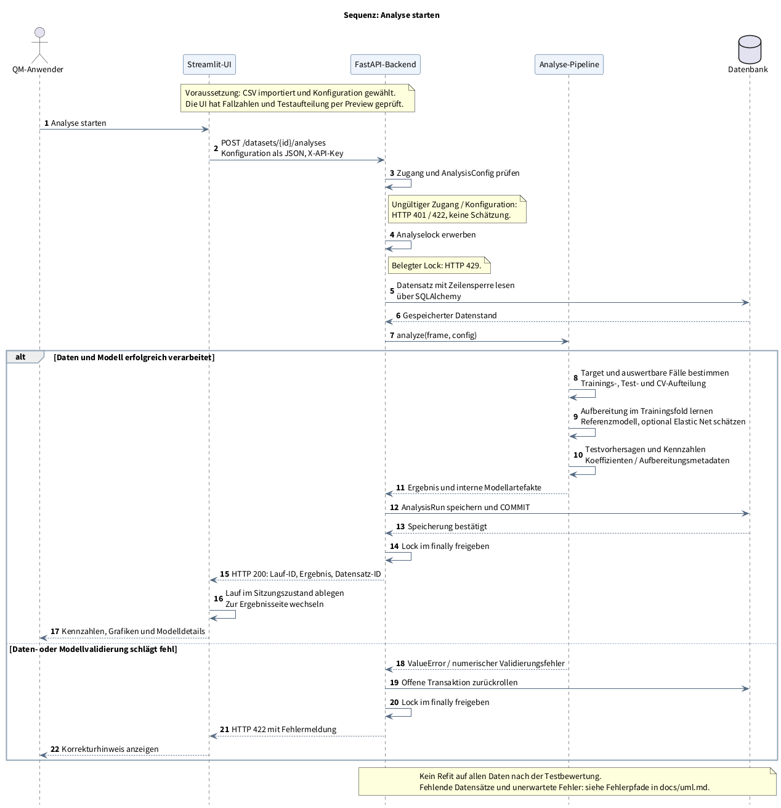

# UML-Konzeption

Diese drei UML-Sichten beschreiben den implementierten Stand der QM-Regressionswerkstatt: Nutzerziele, Komponenten und die Zusammenarbeit bei einem Analyselauf. Sie ergänzen die [Architekturentscheidungen](design.md) und die [Methodendokumentation](methods.md).

Die versionierten PlantUML-Quellen liegen unter [uml/](uml/). Die Diagramme sind als PNG eingebunden, damit GitHub sie ohne externen Diagrammdienst und ohne Schriftwechsel darstellt. Die Beschriftung verwendet wie die App **Source Sans Pro**.

## Anwendungsfalldiagramm

**Welche Aufgaben kann ein Nutzer mit dem System erledigen?** Der Rahmen zeigt die Systemgrenze, die Ellipsen die Nutzerziele und die Verbindungslinien die Beteiligung des Akteurs. Die Darstellung bildet keine zeitliche Reihenfolge ab.



Es gibt einen fachlichen Akteur „QM-Anwender“. Alle Personen mit dem gemeinsamen Zugangsschlüssel besitzen dieselben Rechte; eine zusätzliche Administratorrolle wäre derzeit irreführend. „Analyse konfigurieren und ausführen“ umfasst die Wahl von Target, Features, Aufbereitung und Testdesign. Beim Export sind HTML-Bericht, CSV-Ergebnisse und JSON-Konfiguration gemeint. Löschungen erfordern eine ausdrückliche Bestätigung; eine Datensatzlöschung betrifft auch dessen gespeicherte Läufe und Modelle.

**Codebezug:** [Vorbereitung](../qmworkbench/prepare_ui.py), [Ergebnisse](../qmworkbench/results_ui.py), [Verwaltung](../qmworkbench/saved_ui.py). [PlantUML-Quelle](uml/use-cases.puml).

## Komponentendiagramm

**Welche Bausteine tragen welche Verantwortung?** Die Komponentensymbole stellen logische Softwarebausteine dar. Gestrichelte Pfeile zeigen Nutzungsabhängigkeiten. Die Rahmen ordnen sie den beiden Anwendungsdiensten zu; PostgreSQL ist der separate Datenbankdienst. Die Analyse-Pipeline, der Persistenzzugriff und die Berichtserzeugung sind Module im API-Prozess, keine zusätzlichen Server.


| Baustein | Verantwortung und Abgrenzung |
|---|---|
| Streamlit-Oberfläche | Drei Arbeitsbereiche, API-Client und Sitzungszustand. Plotly-Grafiken entstehen in der UI aus gespeicherten Ergebnissen. |
| HTTP-API und Validierung | Authentifizierung, Konfigurationsprüfung, Analysekoordination, Transaktionen und Datenrouten. |
| Analyse-Pipeline | Targetbildung, Datenaufteilung, trainingslokale Aufbereitung, Regression und Testbewertung. |
| Persistenzzugriff | ORM-Datenmodell und SQLAlchemy-Sitzungen. Die API steuert das Speichern und Commit/Rollback. |
| Bericht und CSV-Export | HTML-Bericht und sichere CSV-Aufbereitung. Die API liefert die JSON-Konfiguration direkt aus. |
| PostgreSQL | Datenstände und zugehörige Analyseläufe einschließlich interner Modellartefakte. SQLite ist die lokale Alternative. |

Die UI greift nicht direkt auf die Datenbank zu. Geräte-, ERP- und Cloud-Adapter sind nicht implementiert und werden deshalb nicht als Komponenten dargestellt. [PlantUML-Quelle](uml/components.puml).

## Sequenzdiagramm

**Was passiert nach dem Klick auf „Analyse starten“?** Die Zeit verläuft von oben nach unten. Durchgezogene Pfeile zeigen Aufrufe, gestrichelte Pfeile Rückgaben. Der `alt`-Rahmen trennt den fachlichen Fehlerfall vom erfolgreichen Analyselauf.



Die Vorschau ist eine Voraussetzung dieses UI-Ablaufs: Sie verwendet die vollständigen Daten, prüft Target und Aufteilung, schätzt aber noch kein Modell. Das Backend wiederholt die erforderlichen Prüfungen beim Start. Eine erfolgreiche API-Antwort erfolgt erst nach dem Commit des neuen Analyselaufs. Der Prozesslock wird auch bei Fehlern im `finally`-Block freigegeben. Testdaten bestimmen weder Imputations-/Skalierungsparameter noch die Elastic-Net-Suche.

Das Diagramm konzentriert sich auf den Analyseauftrag und dessen Ergebnis. Die zusätzliche HTML-/CSV-Abfrage beim Rendern der Ergebnisseite sowie das spätere Öffnen oder Löschen von Läufen sind eigene Anwendungsfälle und hier ausgelassen.

| Fehlerpfad | Verhalten im Code |
|---|---|
| Zugang ungültig / Schlüssel nicht konfiguriert | HTTP 401 / 503. Kein Analyselauf wird angelegt. |
| Konfiguration oder Daten ungeeignet | HTTP 422. Die UI zeigt eine Fehlermeldung. Kein neuer Ergebnislauf. |
| Datensatz nicht mehr vorhanden | HTTP 404. Eine Analyse wird nicht ausgeführt. |
| Analyseprozess bereits belegt | HTTP 429. Keine zweite gleichzeitige Schätzung in diesem API-Prozess. |
| Unerwarteter Analyse- oder Speicherfehler | HTTP 500. Offene Transaktion wird zurückgerollt, Fehler serverseitig protokolliert. |

**Codebezug:** [UI-Aufruf](../qmworkbench/prepare_ui.py), [HTTP-Client](../qmworkbench/ui.py), [Analyse-Endpunkt](../qmworkbench/api.py), [Pipeline](../qmworkbench/analysis.py), [Datenmodell](../qmworkbench/storage.py). [PlantUML-Quelle](uml/analysis-sequence.puml).

## Diagramme aktualisieren

Die Bilder wurden lokal mit PlantUML 1.2025.2 erzeugt. Für Komponenten und Anwendungsfälle ist der integrierte Smetana-Layoutmechanismus aktiviert; ein separater Graphviz-Dienst ist nicht erforderlich. Java und die lokal installierte Schrift Source Sans Pro genügen zusammen mit einer PlantUML-JAR:

```bash
java -Djava.awt.headless=true -jar /pfad/zu/plantuml.jar -charset UTF-8 -tpng docs/uml/*.puml
```

Die erzeugten Dateien aus `docs/uml/` als `uml-use-cases.png`, `uml-components.png` und `uml-analysis-sequence.png` nach `docs/assets/` übernehmen. Nach Änderungen Quellen, Diagramme und Codebezug gemeinsam prüfen. PlantUML und die Schrift sind Dokumentationswerkzeuge und keine zusätzlichen Laufzeitabhängigkeiten der App.
